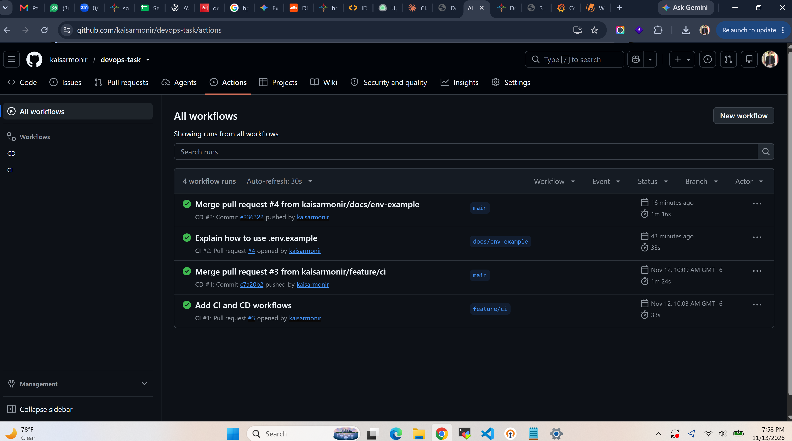
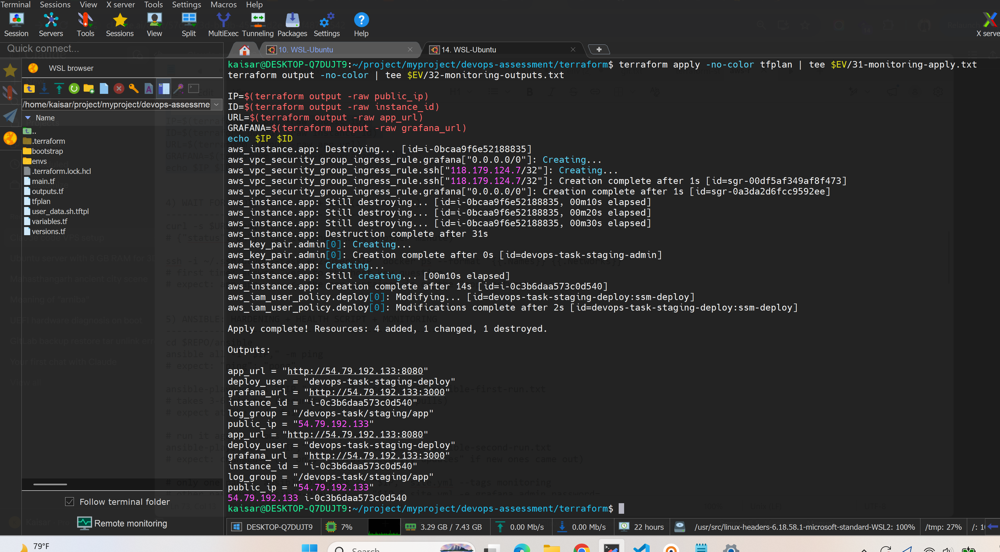
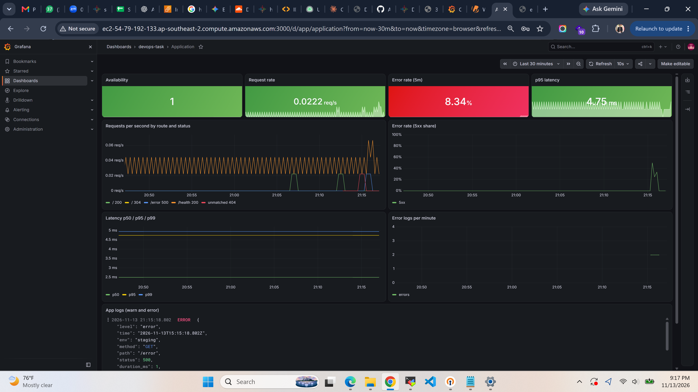
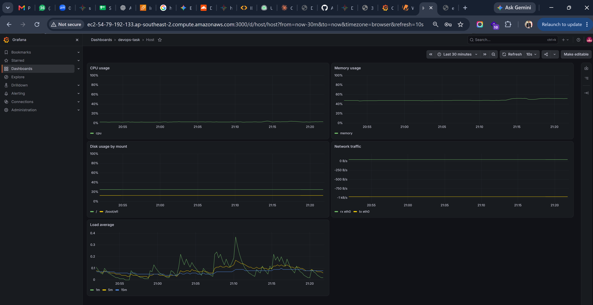
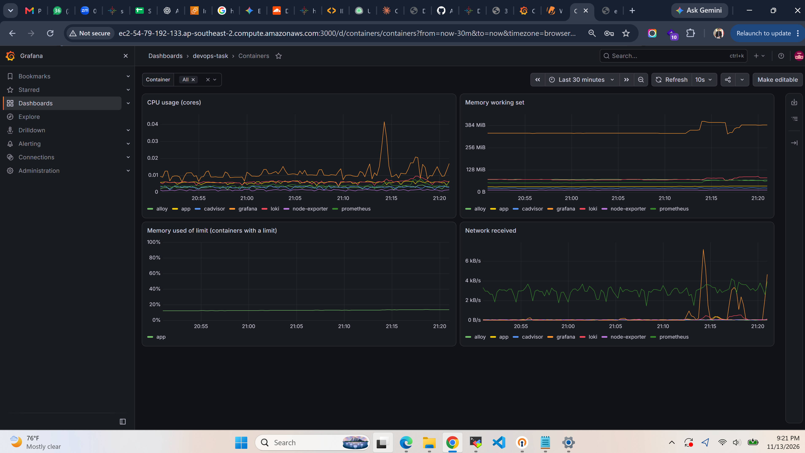
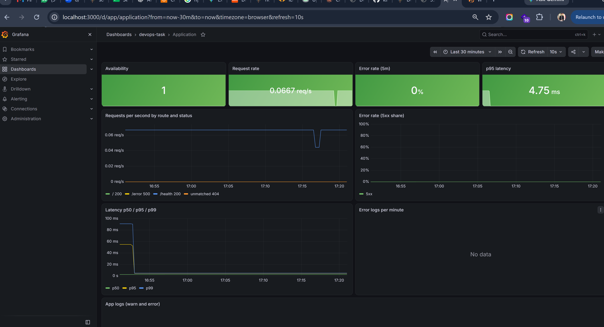

# DevOps Task

A small Node.js web service, built, shipped, deployed and monitored end to end:
Docker, GitHub Actions, Terraform on AWS EC2, Kubernetes (kind, plain manifests and Helm),
Prometheus, Grafana, Loki, Alloy, Ansible and a Bash health script.

The app itself is kept very simple on purpose. The time went into the DevOps parts.


## Live demo (temporary)

The staging environment on AWS is up while the task is being reviewed. It will be
destroyed afterwards, the screenshots below show the same thing.

- **App:** http://ec2-54-79-192-133.ap-southeast-2.compute.amazonaws.com:8080 (IP: http://54.79.192.133:8080)
- **Grafana:** http://ec2-54-79-192-133.ap-southeast-2.compute.amazonaws.com:3000 (IP: http://54.79.192.133:3000)
- **Grafana login:** user `admin`, password `gRadEvopsatsK`
- Dashboards are under **Dashboards → devops-task**: Application, Host, Containers

The Grafana password is in the repo (`ansible/group_vars/all.yml`) only because this is a
short-lived test environment that other people need to open. A real environment would keep
it in Ansible Vault or AWS SSM Parameter Store.

To produce some traffic and errors for the dashboards:

```
URL=http://ec2-54-79-192-133.ap-southeast-2.compute.amazonaws.com:8080
for i in $(seq 1 200); do curl -s -o /dev/null $URL/; curl -s -o /dev/null $URL/error; done
```


## What is in the repo

- `app/` - the Node.js + Express service, unit tests, ESLint config
- `Dockerfile`, `.dockerignore`, `docker-compose.yml` - container and local run
- `docker-compose.monitoring.yml`, `monitoring/` - Prometheus, Grafana, Loki, Alloy, Node Exporter, cAdvisor
- `.github/workflows/` - `ci.yml` (pull requests) and `cd.yml` (main branch)
- `terraform/` - EC2, IAM, security group, CloudWatch logs, S3 remote state
- `k8s/` - Kubernetes manifests (Kustomize) for a local kind cluster
- `helm/devops-task/` - the same app as a Helm chart, with staging and production values
- `ansible/` - server hardening, health script and monitoring stack for the EC2 host
- `scripts/` - `system_health.sh`, `deploy_ec2.sh`, `kind_up.sh`
- `systemd/` - service, timer and logrotate config for the health script
- `docs/` - screenshots and saved command output (evidence)


## The app

**Endpoints:**
- `GET /` returns `{"message":"Hello from DevOps Task!","status":"running","version":"..."}`
- `GET /health` returns `{"status":"ok"}`, used by Docker, Kubernetes and the deploy smoke test
- `GET /metrics` Prometheus metrics
- `GET /error` always returns 500, so the error metric, alert and dashboards can be tested

**Configuration** is only through environment variables: `PORT` (default 8080),
`LOG_LEVEL` (default info), `APP_ENV`, `APP_VERSION` (set from the image tag).

**Logs** are JSON lines on stdout, one per request, with `level`, `method`, `path`,
`status` and `duration_ms`. 4xx are logged as `warn`, 5xx as `error`. Requests to
`/metrics` are not logged, Prometheus calls it every 15 seconds.

**Metrics:** `http_requests_total`, `http_errors_total` and the histogram
`http_request_duration_seconds`, all with the labels `method`, `route`, `status`, plus the
default Node.js process metrics. The `route` label is the route pattern, not the raw URL.
Unknown paths become `unmatched`, so random URLs can not create new time series.

**Shutdown:** on SIGTERM the server stops taking new connections, finishes open requests
and exits (forced after 10 seconds).


## Prerequisites

For the local part:
- Docker with the compose plugin
- Node.js 24 and npm (only to run the tests outside Docker)
- kind, kubectl and Helm (only for the Kubernetes part)

For the AWS part:
- An AWS account and the AWS CLI, logged in
- Terraform 1.10 or newer
- Ansible (ansible-core is enough, no extra collections are used)
- jq and curl (used by the deploy script)


## Run the app locally

```
docker compose up -d --build
curl localhost:8080/
curl localhost:8080/health
docker compose down
```

The container runs as a non-root user with a read-only filesystem, 0.5 CPU and 256MB
memory limits, a health check and `restart: unless-stopped`.


## Run the app with the monitoring stack

```
cp .env.example .env        # then set GRAFANA_ADMIN_PASSWORD in .env
docker compose -f docker-compose.yml -f docker-compose.monitoring.yml up -d --build
```

- Open Grafana at http://localhost:3000 and log in with the user and password from `.env`
- Dashboards: **Dashboards → devops-task** (Application, Host, Containers)
- The first start of Grafana takes 1-3 minutes (it creates its database)
- Only Grafana (3000) and the app (8080) are published to the host

Stop everything with:

```
docker compose -f docker-compose.yml -f docker-compose.monitoring.yml down
```


## Run the tests

```
cd app
npm ci
npm run lint
npm test          # jest with coverage, about 93%
```

The tests use supertest against the Express app without opening a port.


## Health script

`scripts/system_health.sh` reports CPU, memory, every mounted filesystem, load average and
the top 5 processes by memory.

```
./scripts/system_health.sh
./scripts/system_health.sh --json
./scripts/system_health.sh --disk 80 --cpu 90 --mem 85 --critical 95
./scripts/system_health.sh --help
```

- The flags are warning levels. `--critical` is one level for all checks.
- Exit codes: **0** healthy, **1** warning, **2** critical (also 2 for bad arguments).
- When a check is over its level, the last line says which one, for example
  `[WARNING] Above warning threshold: disk 82%`.
- CPU is measured from two samples of `/proc/stat` one second apart. Memory uses
  `MemAvailable`, not "free", so the page cache does not count as used.
- Read-only and pseudo filesystems (tmpfs, overlay, squashfs) are skipped.
- It uses `set -euo pipefail` and passes shellcheck without warnings (also checked in CI).

**Run every 5 minutes with systemd** (Ansible does the same on the EC2 host):

```
sudo install -m 0755 scripts/system_health.sh /usr/local/bin/
sudo install -m 0644 systemd/system-health.service systemd/system-health.timer /etc/systemd/system/
sudo install -m 0644 systemd/system-health.logrotate /etc/logrotate.d/system-health
sudo systemctl daemon-reload
sudo systemctl enable --now system-health.timer
```

The service appends the JSON output to `/var/log/system-health.log`. logrotate rotates it
daily and keeps 7 compressed copies. Exit code 1 (warning) does not mark the unit as
failed, only 2 (critical) does.


## CI/CD (GitHub Actions)

**CI** (`.github/workflows/ci.yml`) runs on every pull request to main:
- npm ci, ESLint, Jest with coverage
- shellcheck on all scripts
- hadolint on the Dockerfile
- docker build, then a Trivy scan that fails the build on CRITICAL vulnerabilities that have a fix

**CD** (`.github/workflows/cd.yml`) runs on every push to main and on `v*.*.*` tags:
- Builds the image for amd64 and arm64 with Buildx, with the GitHub Actions cache
- Pushes to GHCR: `ghcr.io/kaisarmonir/devops-task`
- Tags: `sha-<short commit>` for every build, and `1.2.3` style tags for git tags `v1.2.3`.
  There is no `latest` tag, every deploy points at an exact version
- Deploy job (main only, GitHub environment `staging`): runs `scripts/deploy_ec2.sh`, which
  deploys the new image over AWS SSM, smoke tests it and rolls back if the test fails

**Branches:** every piece of work was done on its own `feature/...` or `fix/...` branch.
The branches are kept on GitHub so the history is visible.




## Terraform (AWS)

Region `ap-southeast-2`. The code creates, per environment:
- An EC2 instance (Amazon Linux 2023), IMDSv2 required, encrypted gp3 disk
- A security group: app port 8080 open, SSH (22) only from `admin_cidrs`, Grafana (3000)
  only from `grafana_cidrs`. Outgoing traffic only on 443
- An instance role with the SSM agent policy and write access to its own log group only
- A CloudWatch log group (`/devops-task/<env>/app`), 7 days retention in staging, 30 in production
- Deploy access for GitHub: only `ssm:SendCommand` on this one instance (see Security)
- On first boot, user data installs Docker and starts the app with `/usr/local/bin/run-app`

```
# once per account
cd terraform/bootstrap
terraform init && terraform apply
cd ..

# staging
terraform init \
  -backend-config=envs/staging.backend.hcl \
  -backend-config="bucket=$(terraform -chdir=bootstrap output -raw state_bucket)"

MYIP=$(curl -s https://checkip.amazonaws.com)
terraform plan -var-file=envs/staging.tfvars \
  -var "admin_cidrs=[\"$MYIP/32\"]" \
  -var "ssh_public_key=$(cat ~/.ssh/devops-task.pub)" \
  -out tfplan
terraform apply tfplan
terraform output

# clean up after testing
terraform destroy -var-file=envs/staging.tfvars \
  -var "admin_cidrs=[\"$MYIP/32\"]" \
  -var "ssh_public_key=$(cat ~/.ssh/devops-task.pub)"
```

Production is the same with `envs/production.backend.hcl` and `envs/production.tfvars`.

**GitHub setup for the deploy job:** environment `staging` with the variables `AWS_REGION`,
`EC2_INSTANCE_ID`, `APP_URL` and the secrets `AWS_ACCESS_KEY_ID`, `AWS_SECRET_ACCESS_KEY`
(the key of the `devops-task-staging-deploy` user, created by hand so it never ends up in
the Terraform state).




## Ansible (EC2 host)

After `terraform apply`, one playbook configures the host:

```
cd ansible
ansible-playbook -i "<public ip>," site.yml
```

- **Hardening:** security updates, SSH with keys only (no password logins at all, root only
  with a key), `MaxAuthTries 3`, `AllowUsers ec2-user root`, a few network sysctl settings
- **Health script:** the script, systemd service and timer, logrotate config
- **Monitoring:** installs the Docker compose plugin and starts the same monitoring stack as
  locally in `/opt/monitoring`. `ansible/files/docker-compose.server.yml` joins the existing
  `app` network that `run-app` creates
- Tags `hardening`, `health`, `monitoring` run one part only
- A second run reports `changed=0` (see `docs/evidence/11-ansible-second-run.txt`)


## Kubernetes (kind)

**Create the cluster** (kind, cloud-provider-kind for Ingress and LoadBalancer IPs,
metrics-server for the autoscaler):

```
./scripts/kind_up.sh
```

**Plain manifests with Kustomize** (`k8s/`):

```
cp k8s/secret.env.example k8s/secret.env
kubectl apply -k k8s/
kubectl -n devops-task get pods,svc,ingress,hpa
IP=$(kubectl -n devops-task get ingress app -o jsonpath='{.status.loadBalancer.ingress[0].ip}')
curl http://$IP/
```

What the Deployment does:
- 2 replicas, rolling update with `maxUnavailable: 0` and `maxSurge: 1`, so 2 pods are
  always ready during an update
- Readiness probe every 5s, liveness probe every 10s after 10s, both on `/health`
- `preStop` sleep of 5s, so the pod is removed from the Service before it gets SIGTERM
- Requests 50m CPU / 64Mi, limits 250m / 128Mi
- Runs as uid 1000, read-only root filesystem, all capabilities dropped, seccomp
  RuntimeDefault, no service account token
- HorizontalPodAutoscaler: 2 to 5 replicas at 70% CPU
- Config in a ConfigMap, secrets from a git-ignored file through Kustomize's secretGenerator.
  The secret name gets a hash, so changing a secret rolls the pods

**Rolling update and rollback:**

```
kubectl -n devops-task set image deployment/app app=ghcr.io/kaisarmonir/devops-task:sha-a5d1eb4
kubectl -n devops-task rollout status deployment/app
kubectl -n devops-task rollout history deployment/app
kubectl -n devops-task rollout undo deployment/app
```

Measured: 934 requests at about 10 per second through the Ingress during an update and an
undo, **0 failed**. Under load the autoscaler went from 2 to 5 replicas in about 60 seconds.

**Helm chart** (`helm/devops-task/`), the same app with separate values per environment:

```
helm upgrade --install devops-task helm/devops-task \
  -n devops-task-staging --create-namespace \
  -f helm/devops-task/values-staging.yaml --set secretEnv.API_TOKEN=demo --wait

helm upgrade --install devops-task helm/devops-task \
  -n devops-task-production --create-namespace \
  -f helm/devops-task/values-production.yaml --set secretEnv.API_TOKEN=demo --wait

helm history devops-task -n devops-task-staging
helm rollback devops-task -n devops-task-staging
```

- Staging: 2-3 replicas, `LOG_LEVEL=debug`, host `staging.devops-task.local`
- Production: 3-10 replicas, more CPU and memory, a PodDisruptionBudget (2 pods always up),
  host `devops-task.local`
- Config and secret changes roll the pods (checksum annotations)
- Secret values are only passed with `--set`, never written in a values file

Measured: image upgrade and `helm rollback` under constant traffic, 1116 requests,
**0 failed**.


## Architecture

**From commit to EC2:**
developer pushes a branch → pull request → CI (ESLint, Jest, shellcheck, hadolint, docker
build, Trivy) → merge to main → CD builds amd64 + arm64 image → pushed to GHCR as
`sha-<commit>` → deploy job calls AWS SSM → EC2 runs `run-app <image>` → smoke test on
`/health` and `/` → done, or roll back to the image that was running before.

**On the EC2 host:**
Docker runs the app container and the monitoring stack. App logs go to CloudWatch (awslogs
driver) and to Loki (Alloy). Only ports 8080 (everyone), 3000 (everyone, test env) and 22
(admin IP) are open.

**Kubernetes flow:**
image from GHCR → Deployment (2+ pods) → Service → Ingress (cloud-provider-kind) → user.
The HPA reads CPU from metrics-server and changes the replica count.

**Metrics flow:**
app `/metrics`, Node Exporter (host) and cAdvisor (containers) → scraped by Prometheus
every 15s → alert rules in Prometheus → Grafana dashboards.

**Logs flow:**
containers write to stdout → Alloy finds all containers through the Docker API, parses the
app's JSON and adds labels → Loki → Grafana logs panels and Explore.


## Monitoring and logging

All six components run in Docker on an internal network called `monitoring`. That network
has no internet access and no published ports. Prometheus also joins the `app` network to
scrape the app, Grafana joins it only because a container needs one normal network to
publish its port. All images are pinned to exact versions.

**Retention:** Prometheus keeps 7 days or 1GB, whichever comes first. Loki keeps 7 days
(compactor with retention enabled).

**Grafana** gets its data sources and dashboards from files in `monitoring/grafana/`,
nothing is set up by hand. The admin password comes from an environment variable
(`.env` locally, the Ansible variable on the server).

**Log labels.** Every label value creates a new stream in Loki, so labels are kept few and
small:
- `container` and `service` (the compose service, or the container name for containers
  not started by compose)
- `level` (info, warn, error), parsed from the app's JSON
- `path` is stored as structured metadata, not as a label. It can still be filtered,
  without creating a stream per URL
- Status, method and duration stay in the log line and are filtered at query time with
  `| json`

**Mounts and privileges:**
- **Node Exporter** reads `/proc`, `/sys` and `/` read-only to see host CPU, memory and
  disks. Its own filesystem is read-only, `no-new-privileges`, not privileged, no host
  network or PID namespace. Trade-off: without the host network, the network panel shows
  the exporter's own interface, not the host NIC. Host networking would fix that but would
  expose port 9100 on the host
- **cAdvisor** reads `/`, `/var/run`, `/sys` and `/var/lib/docker` read-only, plus the
  `/dev/kmsg` device for OOM events. It is not privileged
- **Alloy** mounts the Docker socket read-only to find containers. This is the most
  powerful mount in the stack: the Docker API is still writable through a read-only socket
  mount, so it is close to root on the host. A socket proxy that only allows read calls
  would be safer

**Alerts** (`monitoring/prometheus/alerts.yml`). The thresholds are starting points for
this small service, not universal values:
- **AppDown:** `up == 0` for 1 minute. One missed scrape can be noise, four misses in a row
  (15s interval) is a real outage
- **HighErrorRate:** more than 5% of requests return 5xx for 5 minutes. A few errors are
  normal, 5% for 5 minutes means many users are affected. `/metrics` requests are left out
  so Prometheus traffic does not hide errors
- **HostDiskUsageHigh:** a disk over 80% for 5 minutes. Leaves time to act before it is
  full. Read-only filesystems are skipped (they are always 100%)
- **ContainerMemoryNearLimit:** a container over 85% of its memory limit for 5 minutes.
  Close to an OOM kill, but short spikes are ignored

The alerts show in Prometheus and on Grafana's Alerting page. There is no Alertmanager,
so nobody gets notified yet (see "What I would improve").

**Dashboards:**

Application: availability, request rate, error rate, p50/p95/p99 latency, and the app's
warn and error logs from Loki in the same view. This one is from the EC2 host during a
test with errors:



Host: CPU, memory, disk per mount, network, load average from Node Exporter:



Containers: CPU and memory per container from cAdvisor, and memory as a percentage of the
configured limit (only the app has a limit):



**An error spike appears on the Application dashboard. How do you find the cause?**
1. The **Error rate** panel goes red. Look at **Requests per second by route and status**
   to see which route and status code the errors come from (in the screenshot: `/error 500`).
2. Check **Latency**: if latency went up at the same time, the app may be slow or
   overloaded rather than failing on one route.
3. Scroll down to **App logs (warn and error)**, it covers the same time range. The error
   lines show the path, status and the error message with stack trace.
4. For more detail open **Explore** with Loki and filter, for example
   `{service="app", level="error"} | json | path="/error"`.
5. Rule out resources on the **Containers** dashboard (is the app close to its memory
   limit or using all its CPU?) and the **Host** dashboard (disk full, CPU or memory).
6. Check if the spike started right after a deploy (compare with the GitHub Actions run
   time). If yes, roll back to the previous image (see below).


## Design decisions

**Node.js + Express** for the app: it is small and quick to write, so the time could go
into the delivery and operations side.

**Alpine instead of distroless:** Alpine has a shell and `wget`, so the Docker health check
and `docker exec ... sh` for debugging just work. Distroless would be smaller (about 45MB
instead of 64.5MB compressed) and have fewer packages, but needs a Node based health check
and has no shell. For this task the easier operation was worth more than 20MB.

**Small, hardened image:** two stages (dependencies are installed in the first), only
`node_modules`, `package.json` and `src` in the final image, npm, yarn and corepack removed
(not needed at runtime and they bring their own vulnerabilities), files owned by root and
the process runs as `node`, so the app can not change its own code. Node runs directly,
not through `npm start`, so it receives SIGTERM. Final size: **64.5MB compressed**.

**Base image pinned by version** (`node:24.22.2-alpine3.23`), not by digest. A digest also
protects against a re-pushed tag, but is harder to read and to update.

**EC2 instead of ECS or EKS:** the task asks for EC2, it is the cheapest and simplest for
one container. ECS Fargate would be the next step for real production (no servers to patch,
built in rolling deploys behind a load balancer). EKS is too much for one small service.

**SSM instead of SSH for deploys:** no SSH key in GitHub and no open port for CI. The deploy
credentials can only send commands to this one instance. SSH (22) is only opened for
Ansible, only from the admin IP.

**IAM user instead of GitHub OIDC:** the plan was a GitHub OIDC role (no long-lived keys).
The AWS account used for this task has an organization policy that blocks creating OIDC
providers, so the code supports both: `github_oidc = true` creates the OIDC role, `false`
creates an IAM user with exactly the same narrow policy. The access key is created by hand
so it never lands in the Terraform state.

**Image tags:** `sha-<commit>` for every build (immutable, every deploy can be traced to a
commit) and semver for releases. No `latest`.

**Secrets:** GitHub Actions uses environment secrets (AWS key) and the built in
`GITHUB_TOKEN` for GHCR. Kubernetes secrets come from a git-ignored file (Kustomize) or
`--set` (Helm), never from the repo. Locally Grafana's password is in a git-ignored `.env`.
In production I would use External Secrets with AWS Secrets Manager or Parameter Store.

**Two separate deployments:** EC2 (Docker) and Kubernetes (kind) are separate
demonstrations, as the task asks. The monitoring stack runs with Docker compose both
locally and on EC2, from the same files.

**Prometheus rules instead of Grafana alerting:** the rules are plain files in the repo,
next to the scrape config, and are checked with `promtool`.


## Deployment and rollback strategy

**How a release reaches production safely:**
1. Every change goes through a pull request. CI must pass (lint, tests, shellcheck,
   hadolint, image build, Trivy).
2. Merging to main builds the image once and pushes it with an immutable `sha-` tag.
3. The same image is deployed to staging automatically and smoke tested (`/health` must
   answer and `/` must report the new version).
4. For production the same image tag is promoted (no rebuild), ideally with a manual
   approval on a GitHub `production` environment. In this repo production exists as
   Terraform and Helm config, the automatic pipeline only deploys staging.

**Rollback on EC2:** `deploy_ec2.sh` reads the running image before it deploys. If the pull,
the start or the smoke test fails, it deploys that image again and the job fails. It was
tested with a tag that does not exist: the deploy failed, the old version came back, the
app stayed up. To roll back by hand later, run the CD deploy again with an older tag, or
over SSM:

```
aws ssm send-command --instance-ids <id> --document-name AWS-RunShellScript \
  --parameters 'commands=["/usr/local/bin/run-app ghcr.io/kaisarmonir/devops-task:sha-<old>"]'
```

**Rollback on Kubernetes:** rolling updates never drop below the wanted number of ready
pods, and a new version that fails its readiness probe never gets traffic.
`kubectl rollout undo` or `helm rollback` go back to the previous version in seconds. For
normal work I prefer rolling back by deploying the previous image tag again (the change is
then in git too). `undo` is for emergencies.


## Security considerations

**Secrets:**
- No secrets in the repo, except the Grafana password of the temporary test environment
  (see Live demo). `.env`, `k8s/secret.env`, Terraform state and plans are git-ignored
- AWS keys only in GitHub environment secrets. The environment can only be used from main
- Lesson learned during the task: the AWS key was first saved as a GitHub *variable*
  instead of a *secret*. Variables are shown in plain text, so the key was deleted and a
  new one was created

**Image scanning:** Trivy in CI fails on CRITICAL vulnerabilities that have a fix.
hadolint checks the Dockerfile. The image is small, has no npm and runs as non-root.

**IAM, least privilege:**
- The instance role can only use SSM and write to its own log group
- The deploy credentials can only run `AWS-RunShellScript` on this one instance and read
  the command result. They can not start, stop or create anything
- The Terraform state bucket is encrypted, versioned and not public

**Network exposure:**
- Security group: 8080 open, 3000 open for the test env (closed by default), 22 only from
  the admin IP. Outgoing traffic only on 443
- SSH: keys only, password login disabled for everyone. Root may log in with the key on
  this test host, in production it would be `PermitRootLogin no`
- IMDSv2 is required on the instance (protects against SSRF stealing role credentials)
- In the monitoring stack only Grafana is published. Prometheus, Loki, Alloy, Node Exporter
  and cAdvisor are only on the internal network

**Containers:** non-root, read-only root filesystem, `no-new-privileges`, CPU and memory
limits. In Kubernetes also all capabilities dropped, seccomp RuntimeDefault and no service
account token.

## Evidence

Saved command output is in `docs/evidence/`, screenshots in `docs/screenshots/`:
- `01`-`05` Terraform bootstrap and staging plan/apply
- `06` a deploy over SSM with smoke test
- `07`-`09` the Terraform change for the monitoring host
- `10` the first Ansible run (failed, the Docker plugin folder was missing, fixed since) and
  `11` the run after the fix with `changed=0`
- `12`-`14` Helm staging and production releases

Other results measured during the task:
- Image size 64.5MB compressed, memory use of the app about 22MB of 256MB
- Container user `uid=1000(node)`, writing to `/app` fails (read-only filesystem)
- `docker compose stop`: the app logs "shutting down" and "server closed" and exits with 0
- Kubernetes rolling update and undo: 934 requests, 0 failed. HPA 2 → 5 replicas in ~60s
- Helm upgrade and rollback: 1116 requests, 0 failed
- EC2 deploy with a missing tag: rolled back automatically, app stayed up

Local run of the Application dashboard (no errors at that time):




## What I would improve with more time

- **Alertmanager** with routing to Slack or Discord, so alerts actually notify someone
- **GitHub OIDC** instead of the IAM user access key, in an account that allows it
- **Production deploys** through a GitHub `production` environment with manual approval,
  promoting the same image tag as staging
- **ECS Fargate or an Auto Scaling group behind a load balancer** instead of one EC2
  instance, for zero-downtime deploys and no single point of failure
- **Ansible over SSM** (the aws_ssm connection) so port 22 can stay closed completely
- **Secrets** from AWS Secrets Manager or Parameter Store (Ansible lookup, External Secrets
  in Kubernetes) instead of git-ignored files and a test password in the repo
- **HTTPS** for the app and Grafana (load balancer with an ACM certificate)
- **Monitoring on Kubernetes** with the kube-prometheus-stack Helm chart


## Use of AI tools

I used Claude to draft configs and scripts and to help debug problems, also used ChatGPT to
analyze the task and suggest an approach. I made the design choices, reviewed and tested
every part, and can explain all of it.
